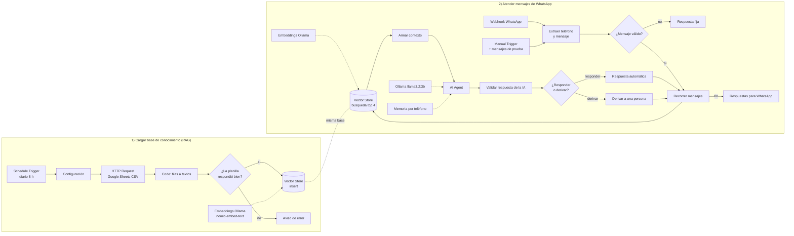
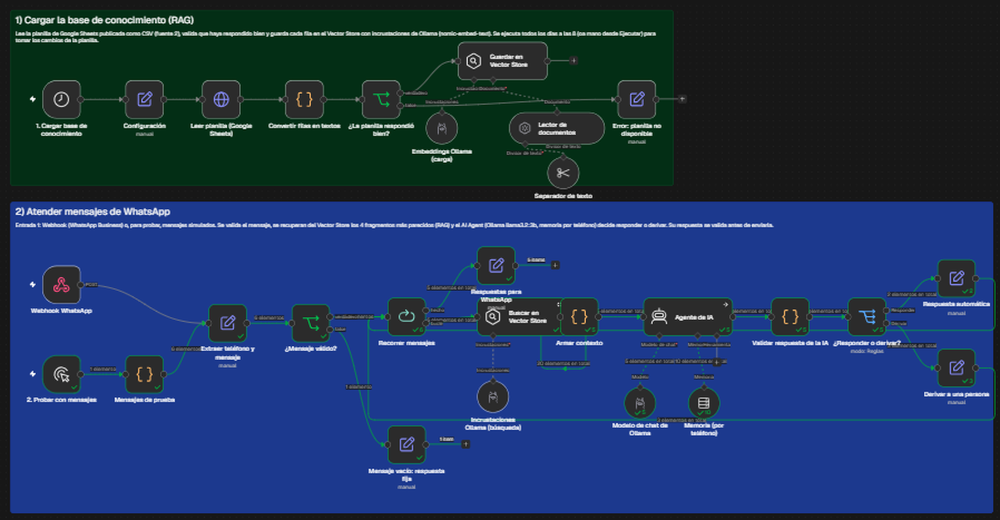
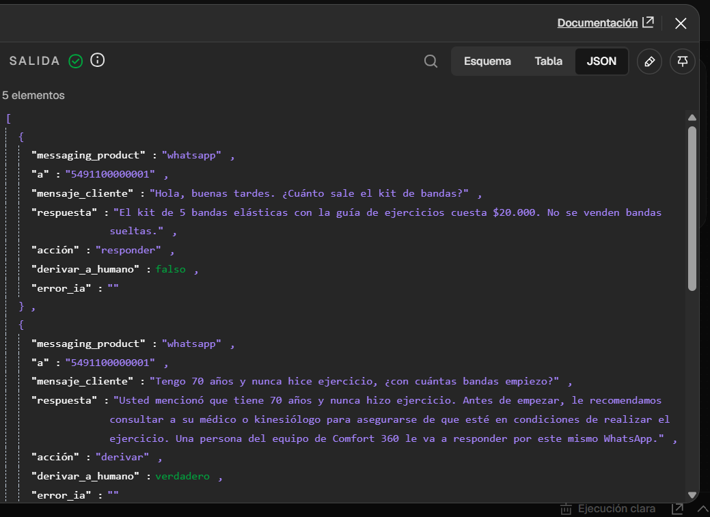
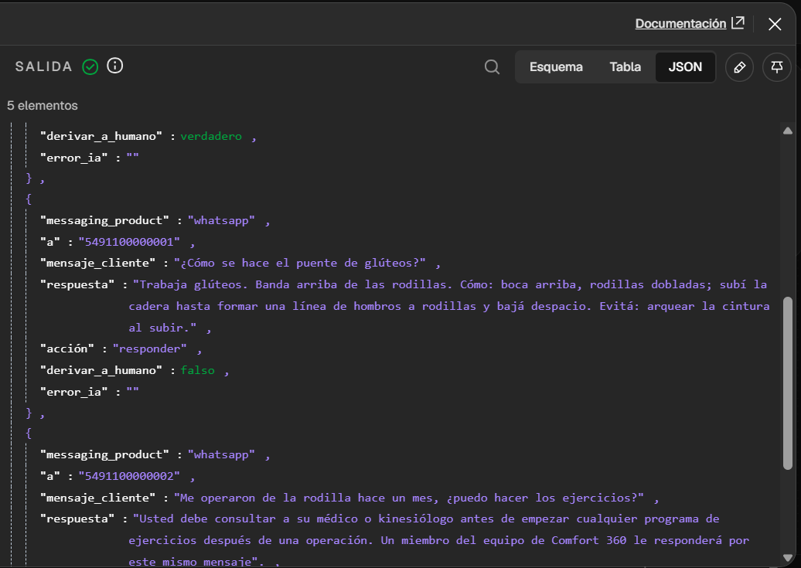
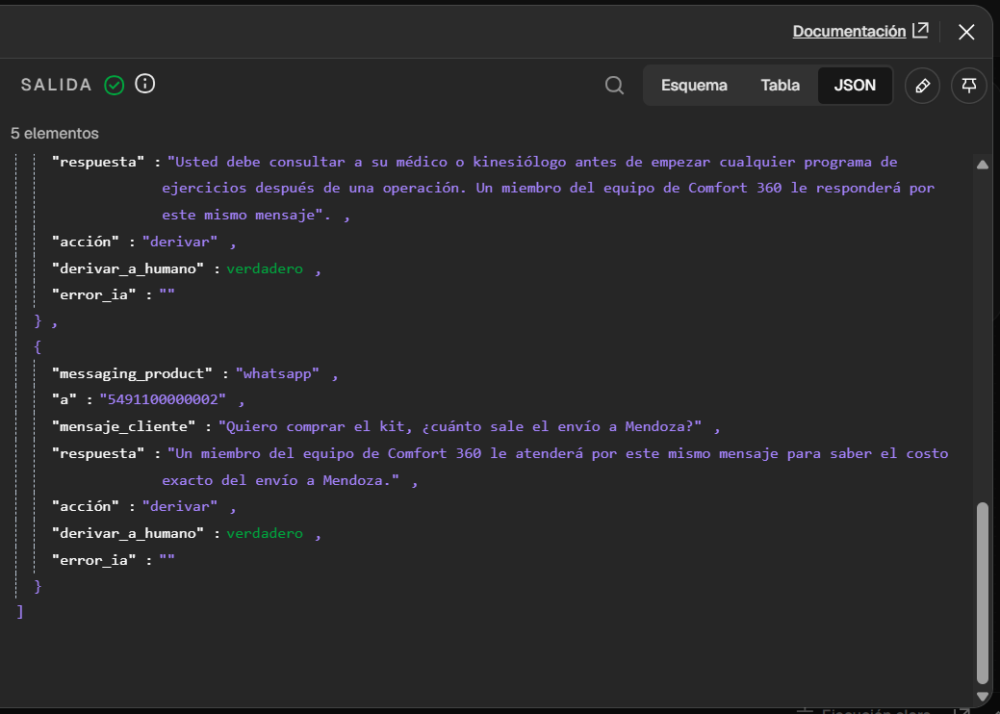

# Asistente de WhatsApp con IA y RAG — Comfort 360

Proyecto Final del curso **AI Automation (n8n)** de Coderhouse · Glenda Oviedo · Noviembre 2026

Asistente autónomo que responde por WhatsApp las consultas de los clientes de **Comfort 360**, un emprendimiento que vende el kit de bandas elásticas **CENIBA** (5 bandas + guía de 11 ejercicios sin impacto para personas mayores). El agente busca la respuesta en la base de conocimiento del negocio (RAG), decide si responde solo o deriva a una persona, y valida su propia respuesta antes de enviarla. Todo corre **en la computadora del negocio**, con n8n y un modelo de IA local (Ollama).

## Contenido del repositorio

| Archivo | Qué es |
| --- | --- |
| `workflow-asistente-comfort360-rag.json` | Workflow exportado de n8n, listo para importar |
| `base_conocimiento_comfort360.csv` | Base de conocimiento (22 filas: producto, envíos, pagos, reglas, plan de 8 semanas y los 11 ejercicios de la guía CENIBA). En producción vive en Google Sheets |
| `capturas/` | Capturas del canvas y de una ejecución de prueba exitosa |

---

## 1. Caso de negocio y ROI

### El proceso manual
Hoy todas las consultas de WhatsApp las responde una persona a mano. Son muy repetitivas: cuánto sale el kit, cómo se usan las bandas, con cuántas empezar, cómo se hace cada ejercicio, si hacen envíos. Muchas llegan fuera de horario y quedan sin respuesta hasta el día siguiente, y en ese tiempo se enfría la venta.

### Estimación del ROI (valores estimados)

| Concepto | Hoy (manual) | Con el asistente |
| --- | --- | --- |
| Consultas por día | 20 | 20 |
| Tiempo por consulta | 4 min (leer, buscar en la guía, escribir) | 0 min si la responde el agente; 4 min si deriva |
| Consultas que resuelve solo | 0 % | ~60 % (producto, ejercicios, plan, uso de las bandas) |
| Tiempo por mes (30 días) | **40 h** | **16 h** (solo las derivadas) |
| Tiempo de respuesta | horas (o el día siguiente) | segundos, las 24 h |
| Costo de operación | — | **$0 por mensaje** (modelo local) + luz de la PC |

- **Ahorro:** unas **24 horas por mes**, que se pueden usar en vender, preparar pedidos y atender los casos que sí necesitan una persona.
- **Costo de implementación:** unas 15 horas de armado y prueba, sin licencias (n8n y Ollama son gratuitos en instalación local). Se recupera en el primer mes.
- **Escala mejor que lo manual:** si las consultas pasan de 20 a 100 por día, la carga manual se multiplica por 5; el asistente las procesa igual y solo crecen las derivadas.

### Límites del ROI: cuándo deja de tener sentido
- Con **menos de 5 consultas por día**, el ahorro es de pocos minutos y no justifica mantener la PC encendida y el sistema actualizado.
- Si la mayoría de los mensajes son **compras o casos de salud** (que siempre se derivan), el agente resuelve poco y el ahorro baja.
- Con **cientos de mensajes por hora**, un modelo local en una PC común se vuelve lento: ahí conviene pasar a un servidor o a un modelo en la nube (ver sección 3).

---

## 2. Arquitectura del workflow



### Entradas (dos fuentes distintas)
1. **Webhook** (`POST /webhook/comfort360-whatsapp`): recibe cada mensaje en el formato de WhatsApp Business (`from` y `text.body`). Para las pruebas, un Manual Trigger genera 5 mensajes con ese mismo formato.
2. **Google Sheets**: la base de conocimiento se edita en una planilla de Google y n8n la lee con un **HTTP Request** al export CSV. Así, el dueño del negocio cambia un precio en la planilla y el asistente lo aprende en la próxima carga (todos los días a las 8 h, o a mano).

### Qué hace cada nodo (y por qué está)

| Nodo | Para qué está |
| --- | --- |
| Configuración (Edit Fields) | Deja el link de la planilla en un solo lugar, fácil de cambiar |
| Leer planilla (HTTP Request) | Trae la planilla como CSV; configurado con *Never Error* para manejar el fallo nosotros |
| Convertir filas en textos (Code) | Pasa cada fila (tema, pregunta, respuesta) a un texto para indexar y marca si la lectura salió bien |
| ¿La planilla respondió bien? (If) | Si la planilla no responde o viene vacía, no se borra ni se ensucia la base: va a la rama de error |
| Guardar en Vector Store + Embeddings + Lector + Separador | Indexación RAG: convierte cada fila en un vector con `nomic-embed-text` y lo guarda |
| Extraer teléfono y mensaje (Edit Fields) | Toma solo `telefono` y `mensaje`, venga del webhook real o de la prueba |
| ¿Mensaje válido? (If) | Evita gastar IA en mensajes vacíos; responde con un saludo fijo |
| Recorrer mensajes (Loop Over Items) | Procesa los mensajes de a uno, para que cada uno tenga su propia búsqueda y su memoria |
| Buscar en Vector Store | Recuperación RAG: trae los 4 fragmentos de la guía más parecidos al mensaje |
| Armar contexto (Code) | Une los fragmentos y arma el mensaje para el agente: CONTEXTO + MENSAJE DEL CLIENTE |
| AI Agent + Ollama + Memoria | El agente decide y redacta; la memoria usa **el teléfono como Session ID** para recordar cada conversación |
| Validar respuesta de la IA (Code) | Revisa que la IA haya devuelto un JSON válido con `accion` y `respuesta`; si no, deriva |
| ¿Responder o derivar? (Switch) | Lleva cada mensaje por el camino que decidió el agente |
| Respuestas para WhatsApp (Edit Fields) | Arma la salida en el formato de la API de WhatsApp (`messaging_product`, `to`, texto) y marca `derivar_a_humano` |

### Salida
La salida es el mensaje listo para enviar por la **API de WhatsApp Business** (`messaging_product`, `to`, `respuesta`) y el webhook la devuelve como respuesta HTTP. Los mensajes con `derivar_a_humano = true` llevan un `aviso_equipo` con el teléfono, la categoría y el mensaje, para que una persona retome la conversación. En producción se agrega el nodo **WhatsApp Business Cloud → Send message** y un aviso por Gmail al equipo.

---

## 3. ¿Por qué un AI Agent con RAG y no un nodo de IA simple?

- **RAG en vez de un prompt fijo:** la información del negocio (precios, envíos, 11 ejercicios, plan de 8 semanas) es demasiado larga para pegarla entera en cada mensaje, y cambia. Con RAG, el asistente busca solo los 4 fragmentos que sirven para esa pregunta, y la información se actualiza editando la planilla, sin tocar el workflow. Además, reduce las alucinaciones: el prompt le prohíbe responder lo que no esté en el CONTEXTO.
- **AI Agent en vez de un nodo de IA simple:** el paso no solo genera texto, **toma una decisión**: responder o derivar a una persona, y clasifica la consulta (producto, ejercicios, compra, salud, reclamo). Además usa **memoria por cliente**, así que entiende el contexto de la conversación ("¿y con cuántas empiezo?"). Un nodo de IA simple responde cada mensaje aislado y sin criterio para escalar.

## 4. Decisión de modelo: local (Ollama) vs. nube

Elegí **modelos locales con Ollama**:
- **Chat:** `llama3.2:3b`. Es liviano (2 GB), corre en una notebook común y alcanza para responder preguntas frecuentes en español con un contexto acotado.
- **Embeddings:** `nomic-embed-text`. Es chico (274 MB) y rápido para indexar y buscar la base de conocimiento.

| Criterio | Local (elegido) | Nube (OpenAI, etc.) |
| --- | --- | --- |
| **Costo según volumen** | $0 por mensaje; con 20 a 100 consultas por día no hay gasto variable | Bajo, pero crece con cada mensaje y hay que pagar la API |
| **Privacidad** | Los mensajes no salen de la computadora. Es importante porque los clientes, personas mayores, cuentan **operaciones, dolores y enfermedades** | Los mensajes viajan a un proveedor externo |
| **Independencia** | Funciona aunque el proveedor cambie precios o tenga una caída | Depende de un servicio externo y de su disponibilidad |
| **Contras** | Respuestas más lentas (varios segundos) y la PC tiene que estar encendida | Más rápido y más capaz |

**Si el volumen se multiplica por 10**, la decisión se sostiene en costo y privacidad, pero la latencia empeora: pasaría Ollama a una PC o servidor con placa de video, y la memoria y el Vector Store a servicios persistentes (Postgres / Supabase).

### Vector Store y embeddings
Uso el **Simple Vector Store** de n8n (en memoria) con embeddings de Ollama. La base tiene 22 fragmentos, así que entra holgada en memoria, no necesita cuentas ni servicios externos, y se vuelve a cargar sola todos los días desde la planilla. Su límite es que se borra si n8n se reinicia; por eso la carga es automática y diaria. Si la base creciera a miles de documentos, la pasaría a **Supabase (pgvector)**.

---

## 5. Manejo de errores y casos límite

| # | Qué puede fallar | Cómo lo contempla el flujo |
| --- | --- | --- |
| 1 | **La planilla de Google no responde, da error o viene vacía** | El HTTP Request no frena el flujo (*Never Error*); el Code revisa el `statusCode` y que haya filas con `pregunta` y `respuesta`, y el If **¿La planilla respondió bien?** manda el caso a **Error: planilla no disponible**, sin tocar la base cargada |
| 2 | **La IA falla, no responde o devuelve algo fuera de formato** (respuesta nula del LLM, Ollama apagado) | El AI Agent está configurado para continuar ante error, y el nodo **Validar respuesta de la IA** comprueba que haya un JSON con `accion` válida y `respuesta`. Si no, responde un mensaje seguro ("te responde una persona del equipo") y **deriva**, con el detalle en `error_ia` |
| 3 | **No se encontró información en la base** (Vector Store vacío o pregunta fuera de tema) | Si la búsqueda trae 0 fragmentos, la validación fuerza **derivar**: el agente nunca responde solo sin contexto |
| 4 | **Mensaje vacío** | El If **¿Mensaje válido?** responde un saludo fijo sin usar la IA |
| 5 | **El agente interpreta mal un caso sensible** | El system prompt prohíbe diagnosticar, inventar precios o tomar pedidos, y obliga a derivar compras, envíos, cuotas, reclamos y **cualquier mención de salud** |

Durante las pruebas, el punto 2 funcionó en la práctica: con un error de configuración en la memoria, los 5 mensajes recibieron la respuesta segura y se derivaron, en vez de quedar sin respuesta.

---

## 6. System prompt del agente

```text
ROL
Sos el asistente de WhatsApp de Comfort 360, un emprendimiento que vende el kit de bandas elásticas CENIBA (5 bandas + guía de 11 ejercicios sin impacto), pensado sobre todo para personas mayores.

CÓMO RESPONDÉS
- Usá SOLO la información de la sección CONTEXTO que viene en cada mensaje. Si la respuesta no está ahí, no la inventes: derivá.
- Tono cálido, paciente y respetuoso, con palabras simples. Tratá de "vos"; si el cliente escribe de "usted", respondé de "usted".
- Mensajes cortos, como en WhatsApp: máximo 4 líneas, sin listas largas ni asteriscos. Como mucho un emoji.

QUÉ PODÉS HACER
- Responder dudas sobre el kit, el precio, las bandas, los ejercicios de la guía, el plan de 8 semanas y el Reto CENIBA.
- Explicar cómo se hace un ejercicio de la guía, tal como figura en el contexto.

LÍMITES (QUÉ NO PODÉS HACER)
- No sos médico ni kinesiólogo: no diagnostiques ni indiques tratamientos, ni prometas resultados.
- No inventes precios, costos de envío, descuentos, stock ni plazos.
- No tomes pedidos ni pagos, y no pidas datos de tarjetas, documentos ni datos de salud.

CUÁNDO DERIVAR A UNA PERSONA (accion = "derivar")
- La persona quiere comprar, pregunta el costo de envío a su provincia, o pregunta por cuotas o descuentos.
- Menciona dolor, una lesión, una operación o una enfermedad: respondé con amabilidad que consulte a su médico o kinesiólogo antes de empezar, y derivá.
- Tiene un reclamo, pide hablar con alguien, o el mensaje es ambiguo o no está cubierto por el CONTEXTO.
En esos casos, en "respuesta" decile que una persona del equipo de Comfort 360 le va a responder por este mismo WhatsApp.

FORMATO DE SALIDA
Respondé SOLO con un JSON válido, sin texto antes ni después:
{"accion": "responder" o "derivar", "categoria": "producto" | "ejercicios" | "compra" | "salud" | "reclamo" | "otro", "respuesta": "el mensaje para el cliente"}
```

---

## 7. Capturas

### Canvas del workflow


### Ejecución de prueba exitosa (salida de "Respuestas para WhatsApp")
5 mensajes de prueba de 2 clientes: el agente **respondió** el precio y el ejercicio A1 (puente de glúteos) usando la guía, y **derivó** los casos de salud y la compra con envío a Mendoza.





---

## 8. Cómo ejecutarlo

1. Instalar [Ollama](https://ollama.com) y descargar los modelos: `ollama pull llama3.2:3b` y `ollama pull nomic-embed-text`.
2. Instalar Node.js 20 a 24 y levantar n8n: `npx n8n`. Abrir `http://localhost:5678`.
3. Importar `workflow-asistente-comfort360-rag.json` y crear la credencial de **Ollama** con Base URL `http://127.0.0.1:11434`.
4. Cargar `base_conocimiento_comfort360.csv` en una planilla de Google Sheets compartida como "cualquier persona con el enlace puede ver", y poner su link de export CSV en el nodo **Configuración**.
5. Ejecutar **1. Cargar base de conocimiento** y después **2. Probar con mensajes**.
